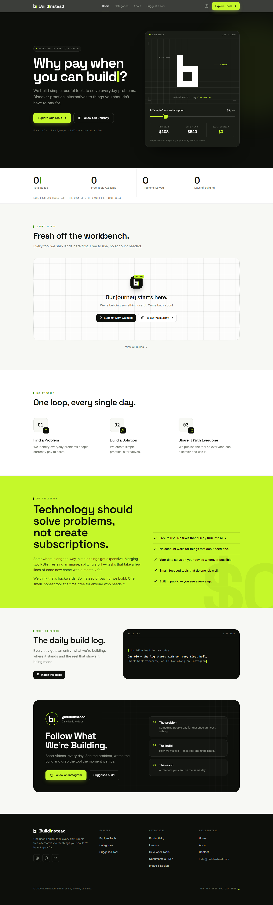

<p align="center">
  <picture>
    <source media="(prefers-color-scheme: dark)" srcset="public/brand/buildinstead-primary-dark-bg.svg" />
    
  </picture>
</p>

<h3 align="center">Why Pay When You Can Build?</h3>

<p align="center">
  One useful digital tool, every day — free for everyone.<br />
  <a href="https://www.instagram.com/buildinstead.dev/">Instagram @buildinstead.dev</a>
</p>

---

## About BuildInstead

BuildInstead is a build-in-public project. Every day we pick an everyday problem that people currently pay to solve — a PDF tool, an image resizer, a calculator, a tracker — and build a simple, free alternative.

- **Instagram** — short videos of each daily build: [@buildinstead.dev](https://www.instagram.com/buildinstead.dev/)
- **Website** (this repository) — where people discover and use everything we build
- **Open source** — projects are shared so developers can learn from them and contribute

### Mission

Make useful digital tools accessible to everyone.

### Philosophy

Technology should solve problems, not create subscriptions. Our tools aim to be free to use, avoid account walls for things that don't need them, keep your data on your device wherever possible, and do one job well.

> One problem. One solution. One build at a time.



---

## Features

What's implemented in this website today:

- **Homepage** — hero with an interactive subscription-cost calculator, live statistics, latest builds, how it works, philosophy, the daily build log and an Instagram section
- **Tools directory** (`/tools`) — search, category filters, sorting by latest or oldest, status badges and shareable filter URLs (e.g. `/tools?category=finance`)
- **Product pages** (`/tools/<slug>`) — problem, features, usage steps, privacy notes, tech used, GitHub and Instagram Reel links, related tools, and a slot for the live tool
- **Categories** (`/categories`, `/categories/<category>`) — eight categories with tool counts
- **About**, **Contact** and **Suggest a Tool** pages — forms submit directly to the server, which emails each submission to the BuildInstead inbox via [Resend](https://resend.com/) (with validation, sanitising, rate limiting, bot protection and duplicate prevention)
- **One-file content management** — every product is a single entry in `src/data/products.ts`; the homepage, directory, categories, statistics, build log and sitemap update automatically
- **Honest by design** — statistics are calculated from the product list (they start at zero), unfinished tools are labelled *Coming Soon* / *In Development*, the "Most popular" sort only appears once real usage data exists, and forms never fake a successful submission
- **SEO** — per-page titles and descriptions, canonical URLs, Open Graph and Twitter cards, generated social images, `sitemap.xml`, `robots.txt`, web manifest and structured data
- **Responsive and accessible** — mobile-first layouts, keyboard-friendly navigation, skip link, reduced-motion support

> **Note:** the build log currently has no published products — the site launches with accurate empty states and fills in as daily builds are added.

---

## Tech stack

- [Next.js 16](https://nextjs.org/) (App Router, static generation)
- [TypeScript](https://www.typescriptlang.org/)
- [Tailwind CSS 4](https://tailwindcss.com/)
- [Lucide](https://lucide.dev/) icons
- Fonts via `next/font`: Space Grotesk, Inter, JetBrains Mono
- [Resend](https://resend.com/) — transactional email for form submissions (REST API; no SDK dependency)
- [Supabase](https://supabase.com/) — **optional**, to also archive form submissions (REST API; no SDK dependency)

---

## Getting started

Requires **Node.js 20.9 or newer**.

```bash
git clone https://github.com/buildinstead-dev/buildinstead-website-.git
cd buildinstead-website-
npm install
cp .env.example .env.local   # optional — the site runs without it
npm run dev
```

Open [http://localhost:3000](http://localhost:3000).

### Commands

| Command | What it does |
|---|---|
| `npm run dev` | Start the development server |
| `npm run build` | Create a production build |
| `npm start` | Serve the production build |
| `npm run typecheck` | Run the TypeScript compiler without emitting |

---

## Environment variables

Copy `.env.example` to `.env.local`. The site runs without any of them, but the forms need email (or Supabase) configured to accept submissions.

| Variable | Required | Purpose |
|---|---|---|
| `NEXT_PUBLIC_SITE_URL` | In production | Public URL used for canonical links, the sitemap and Open Graph tags |
| `RESEND_API_KEY` | For forms | Resend API key — server-only, never sent to the browser |
| `CONTACT_EMAIL` | For forms | Inbox that receives contact messages and tool suggestions |
| `EMAIL_FROM` | For forms | Sender, e.g. `BuildInstead <hello@buildinstead.com>` — must be on a domain verified in Resend |
| `SUPABASE_URL` | No | Supabase project URL — also archives submissions |
| `SUPABASE_ANON_KEY` | No | Supabase anon key — server-side only |

Never commit `.env.local` or real keys — `.gitignore` already excludes them.

### How form submissions work

1. The visitor submits the form; the browser posts JSON to `/api/contact` or `/api/suggestions`.
2. The server checks size, a hidden honeypot field and fill time, applies a per-IP rate limit (5 per 10 minutes per form), validates every field and ignores exact duplicates sent within 10 minutes.
3. It emails the submission to `CONTACT_EMAIL` through Resend, with the visitor's address as *Reply-To*. All user input is HTML-escaped and stripped of control characters; subject lines can't contain line breaks.
4. Only after Resend accepts the email does the visitor see a success message. Failures show a clear error and nothing is faked.
5. If the visitor left an email address, they get a short confirmation. It contains no text they typed, so the form can't be used to send arbitrary content to someone else, and it's limited to 3 per address per hour.

If none of the delivery options are configured, the endpoints answer `503` and the form tells the visitor submissions are temporarily unavailable.

> The rate limiter and duplicate guard live in server memory. On Vercel each running instance has its own memory, so they're best-effort. Use a shared store such as Upstash Redis if you need strict limits.

### Setting up Resend

1. Create an account at [resend.com](https://resend.com/).
2. **Domains → Add Domain** → enter the domain you'll send from (e.g. `buildinstead.com`).
3. Add the DNS records Resend shows (an MX and SPF `TXT` record for the sending subdomain, and a DKIM `TXT` record) at your domain registrar or DNS host. Adding a DMARC record is recommended.
4. Click **Verify** and wait until the domain shows *Verified* (usually minutes, up to 48 hours depending on DNS).
5. **API Keys → Create API Key** with *Sending access*, ideally restricted to that domain. Copy it once — Resend won't show it again.
6. Set `RESEND_API_KEY`, `CONTACT_EMAIL` and `EMAIL_FROM` (an address on the verified domain).

`CONTACT_EMAIL` must be a real mailbox you can read — Resend sends email; it doesn't host your inbox. Use your email provider or a forwarding service for `hello@buildinstead.com`.

### Optional: Supabase archive

Run [`supabase/schema.sql`](supabase/schema.sql) in the Supabase SQL editor (insert-only row-level security, so the public key can't read submissions), then set the two Supabase variables. Submissions are then stored as well as emailed.

Never commit `.env.local` or real keys — `.gitignore` already excludes them.

---

## Adding a new build

1. Add one object to the `products` array in [`src/data/products.ts`](src/data/products.ts) (a commented example is at the top of the file).
2. To make the tool usable, either set `productUrl` (tool hosted elsewhere) or build it in `src/tools/<slug>/index.tsx` and register it in [`src/tools/registry.tsx`](src/tools/registry.tsx).
3. Commit and push — the deployment picks it up automatically.

Statuses: `coming-soon` → `in-development` → `available` → `archived`. Invalid entries (duplicate ids, slugs or days, unknown categories or icons) fail the build with a clear message.

Site-wide links — Instagram, GitHub and contact email — live in [`src/config/site.ts`](src/config/site.ts).

---

## Project structure

```
src/
  app/                     Routes (App Router)
    page.tsx               Homepage
    tools/                 Tools directory and product pages
    categories/            Category index and category pages
    about/ contact/ suggest/
    api/                   Form endpoints (email via Resend, optional Supabase archive)
    sitemap.ts robots.ts manifest.ts opengraph-image.tsx not-found.tsx
    globals.css            Design tokens and base styles
  components/
    brand/                 Logo and social icons
    home/                  Homepage sections and interactive hero
    layout/                Header, footer, page header
    products/              Product card, tools directory, empty state
    forms/                 Suggest and contact forms
    ui/                    Shared primitives (buttons, badges, containers)
  config/site.ts           Site URL, social links, contact email
  data/products.ts         The build log — one entry per product
  data/categories.ts       Categories
  lib/                     Product selectors and stats, validation, email + rate limiting, Supabase client, icons
  tools/registry.tsx       Registry for tools built into the site
public/brand/              Official BuildInstead logo files
supabase/schema.sql        Optional database schema
screenshots/               Screenshots of the website
```

---

## Deployment (Vercel)

1. Import this repository at [vercel.com/new](https://vercel.com/new) — Next.js is detected automatically.
2. Add `NEXT_PUBLIC_SITE_URL` (your domain), `RESEND_API_KEY`, `CONTACT_EMAIL` and `EMAIL_FROM`, plus the Supabase variables if you use them. Mark the Resend key as *Sensitive*.
3. Deploy, then connect your domain under **Settings → Domains**.

Every push to `main` triggers a new deployment.

---

## Brand

| | |
|---|---|
| Ink | `#0D0F0B` |
| Volt Lime | `#C5F82A` |
| Deep Lime | `#3A8F00` |
| Paper | `#F7F8F4` |

The BuildInstead name and logo are brand assets of BuildInstead.

---

<p align="center">
  Follow the journey on Instagram — <a href="https://www.instagram.com/buildinstead.dev/">@buildinstead.dev</a>
</p>
